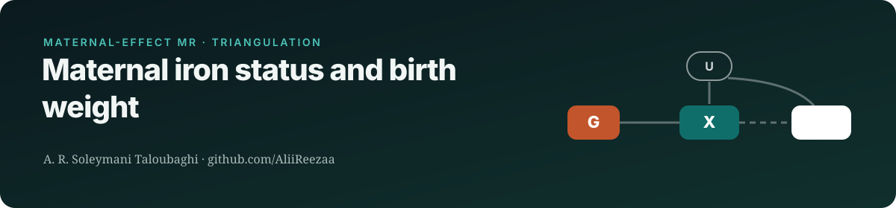
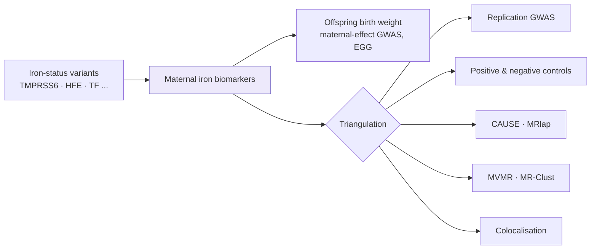

    

> **Status:** manuscript in preparation
>
> This repository is a public overview of an unpublished study. It shows the research question, design and methods. **Results, data and analysis code are withheld until peer-reviewed publication**, and will be released here at that point.

## Research question
Does genetically predicted **maternal** iron status (serum iron, ferritin, transferrin saturation, TIBC) influence offspring birth weight, independent of the fetal genome?

## Study design

## Data sources
| Role | Dataset | Notes |
|---|---|---|
| Exposures | Moksnes et al. 2022 iron biomarkers | four traits |
| Outcome | EGG consortium maternal-adjusted birth weight (Warrington 2019) | N≈297k |
| Controls | type 2 diabetes (positive); hair colour, CAD (negative) | assumption checks |

## Methods
| Component | Approach |
|---|---|
| Core MR | IVW, MR-Egger, weighted median/mode, MR-RAPS, contamination mixture |
| Outliers | MR-PRESSO and radial MR |
| Bias checks | MRlap (sample overlap), CAUSE (correlated pleiotropy), LDSC via GenomicSEM |
| Mechanism | MVMR with inflammatory markers; MR-Clust; colocalisation at TMPRSS6/HFE/TF |

## Why it matters
Iron supplementation in pregnancy is routine worldwide. Genetic evidence on whether iron status itself affects fetal growth can guide supplementation policy.

## Team & role
Co-author **A. R. Soleymani Taloubaghi** (analysis) with collaborators at Tehran University of Medical Sciences.

## Reproducibility
- Analysis pipeline written in R (renv-locked; TwoSampleMR, MendelianRandomization, CAUSE, MRlap, coloc), with pinned package versions and a single entry-point script
- Public summary statistics only; no individual-level data is used or shared
- Reported according to STROBE-MR

---
Contact: <a href="mailto:alirezasoleymani24@gmail.com">alirezasoleymani24@gmail.com</a> · <a href="https://aliireezaa.github.io">aliireezaa.github.io</a>
